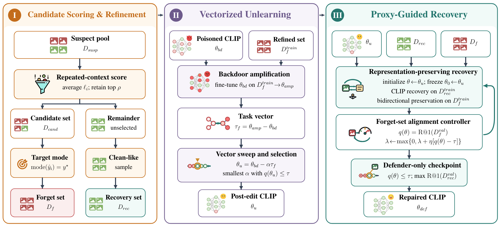

# CLIPSweep: Backdoor Defense in CLIP via Refined Vectorized Unlearning and Proxy-Guided Recovery
### Abstract
CLIP-based vision--language models are vulnerable to backdoor attacks. Vectorized unlearning offers an effective defense in the SoTA research. However, it has an important limitation that relies on a pure forgetting set consisting exclusively of backdoored samples.
When the forgetting set is contaminated with clean examples, unlearning may induce representation drift that degrades clean utility and causes backdoor rebound.  To address this challenge, we propose CLIPSweep, a defense framework that removes backdoors in CLIP through a post-hoc backdoor sweep. First, \emph{Candidate Scoring \& Refinement} combines repeated-context scoring with target-consistency filtering to isolate a high-purity forget set and reserve clean-like data for recovery.  Second, \emph{Vectorized Unlearning} amplifies the refined backdoor signal and subtracts its task vector, suppressing the backdoor along a controllable security--utility sweep.  Finally, \emph{Proxy-Guided Recovery} uses representation preservation and a defender-only alignment proxy to restore clean utility while preventing backdoor rebound.  Across BadNets, Blended, and SIG attacks on ImageNet-1K, CLIPSweep reduces Top-10 ASR from 97.60\%, 99.31\%, and 93.53\% without defense to 4.19\%, 1.48\%, and 0.64\%, respectively, below the lowest ASRs achieved by the baselines (10.98\%, 56.75\%, and 1.17\%). Meanwhile, it retains Top-10 ACC of 88.42\%, 73.72\%, and 85.77\%. Together, these results show that CLIPSweep consistently prioritizes backdoor suppression while accepting attack-dependent utility costs, establishing it as a defense-oriented post-hoc backdoor defense method.

### Framework

# Usage

The main reproducible entry points of this repo are the shell scripts under `scripts/`. Recommended pipeline order:

1. Generate/prepare backdoored data: `scripts/generate.sh`
2. Train a backdoored CLIP (produce a poisoned checkpoint): `scripts/pretrain.sh`
3. ABL-style isolation (produce a higher-purity forget set / clean set): `scripts/isolation.sh`
4. TBAR/TBARC unlearning (produce an unlearned checkpoint + a filtered forget set): `scripts/tbarc.sh`
5. Constrained fine-tuning (suppress backdoor rebound, stabilize representations): `scripts/bd_constraint.sh`

CleanCLIP baseline (optional): `scripts/cleanclip.sh`

Note: the `scripts/*.sh` files are experiment templates. They often contain hard-coded paths (e.g., `/home/user/...`) and GPU indices. You must update them for your machine.

## 0. Data and Directory Conventions

### 0.1 Training CSV (image-caption pairs)

Training scripts expect a CSV with at least two columns:

- `image`: image path (relative or absolute)
- `caption`: text description

Important: in `src/data.py`, if `image` is a relative path, it is resolved relative to the directory that contains the CSV file. For fewer path headaches, keep images and the CSV under the same data root.

### 0.2 ImageNet1K evaluation directory

Most training/evaluation commands use ImageNet1K validation for zero-shot ACC/ASR. You need:

- `data/ImageNet1K/validation/classes.py`: class names and prompt templates
- `data/ImageNet1K/validation/labels.csv`: clean validation index (at least `image` and `label`/`target`)
- the corresponding validation images (paths in `labels.csv` must resolve)

## 1. Environment

This repo does not ship `requirements.txt` / `environment.yml`. Below is a commonly sufficient minimal set (adjust your `torch`/CUDA build as needed):

~~~bash
python -m venv .venv
source .venv/bin/activate

pip install -U pip
pip install numpy pandas tqdm pillow
pip install torch torchvision
pip install lmdb

# tbarc_unlearning.py requires OpenAI CLIP
pip install git+https://github.com/openai/CLIP.git
~~~

If you use wandb:

~~~bash
pip install wandb
~~~

## 2. How to run each script under scripts/

All examples below are executed from the repo root.

### 2.1 scripts/generate.sh: generate backdoored data

Calls: `backdoor/create_backdoor_data.py`

Edit `BASE_PATH` and your `train.csv` path in the script first (replace `/home/user/...` with your local paths), then run:

~~~bash
bash scripts/generate.sh
~~~

Outputs (by default next to your original `train.csv`):

- `backdoor_images_*`: folder containing poisoned images
- `backdoor_<label>_<patch_type>_<patch_location>_<patch_size>_<size>_<num_backdoor>.csv`: mixed training CSV

Common arguments (visible in the script):

- `--num_backdoor`: number of poisoned samples
- `--size_train_data`: total dataset size (clean + backdoor)
- `--patch_type`: `random` / `blended` / `warped` / `SIG` ...
- `--patch_location`: `random` / `blended` / `middle` / `four_corners` ...
- `--patch_size`: trigger size in pixels

### 2.2 scripts/pretrain.sh: train a poisoned CLIP

Calls: `src/main.py` (see `src/parser.py` for arguments)

Run:

~~~bash
bash scripts/pretrain.sh
~~~

You usually only need to change:

- `--train_data`: the `backdoor_*.csv` produced above
- `--eval_test_data_dir`: ImageNet1K validation directory
- `--device_id` or `--device_ids/--distributed`: your GPU configuration

Outputs: `logs/<name>/checkpoints/epoch_*.pt`

Tip: the script uses `--device_ids` + `--distributed` (multi-GPU). For single GPU, replace them with `--device_id X`.

### 2.3 scripts/isolation.sh: ABL-style isolation (produce forget set)

Calls: `python -m backdoor_isolation`

Run:

~~~bash
bash scripts/isolation.sh
~~~

Required inputs:

- `--train_data`: the same mixed CSV used in pretraining
- `--checkpoint`: poisoned checkpoint (e.g., `logs/.../epoch_5.pt`)

Outputs (written under `data/CC3M/`):

- data/CC3M/backdoor_abl_<train_csv_basename>.csv
- data/CC3M/clean_abl_<train_csv_basename>.csv

Key hyperparameters:

- `--isolation_ratio`: isolation ratio (e.g., `0.004` = 0.4%)
- `--tuning_epochs`, `--gamma`: gradient-ascent stage hyperparameters

### 2.4 scripts/tbarc.sh: TBAR/TBARC unlearning

Calls: `tbarc_unlearning.py`

Run:

~~~bash
bash scripts/tbarc.sh
~~~

Required inputs:

- `--theta_poisoned`: poisoned checkpoint
- `--data_dir`: evaluation data root (must contain `classes.py`)
- `--val_set_csv`: clean validation CSV (e.g., `data/ImageNet1K/validation/labels.csv`)
- `--forget_set_csv`: `backdoor_abl_*.csv` produced by the isolation stage
- `--forget_data_dir`: image root for the forget set (default `data/CC3M/`; adjust as needed)
- `--output_dir`: output directory (recommended under `logs/`)

This script also generates, inside `output_dir`:

- <theta_poisoned_basename>_filtered_forget_set.csv

This is the `bd_val_csv` used by the constrained fine-tuning stage.

### 2.5 scripts/bd_constraint.sh: constrained fine-tuning to suppress rebound

Calls: `purify_ft_bd_constraint.py`

Run:

~~~bash
bash scripts/bd_constraint.sh
~~~

Required inputs:

- `--model_path`: an unlearned checkpoint produced by TBAR/TBARC
- `--clean_csv`: `clean_abl_*.csv` from the isolation stage
- `--bd_val_csv`: the `*_filtered_forget_set.csv` produced by TBAR/TBARC
- `--image_root`: image root directory (joined with the `image` column)

Common stability options:

- `--freeze_text`: freeze the text tower
- `--freeze_logit_scale`: freeze `logit_scale`

### 2.6 scripts/cleanclip.sh: CleanCLIP baseline (optional)

Calls: `src/main.py`

Run:

~~~bash
bash scripts/cleanclip.sh
~~~

## 3. What you will most likely need to change

1) Paths: replace `/home/user/...` in `scripts/*.sh` with your local paths.

2) GPU: change `--device_id` / `--device_ids` to match your available GPUs.

3) Data path resolution: ensure `image` in your CSV resolves correctly:

- relative paths are resolved under the directory that contains the CSV file
- if a script provides `image_root` / `forget_data_dir`, prefer setting those explicitly

## 4. FAQ

### Q1: Missing images / FileNotFoundError

Check whether your CSV `image` paths are relative or absolute. Relative paths are resolved under the CSV's directory.

### Q2: tbarc_unlearning.py cannot import clip

Install OpenAI CLIP:

~~~bash
pip install git+https://github.com/openai/CLIP.git
~~~

### Q3: Very slow on macOS

For training and large-scale evaluation, a CUDA-enabled Linux machine is strongly recommended. macOS/CPU is mainly for small-scale debugging.
 
